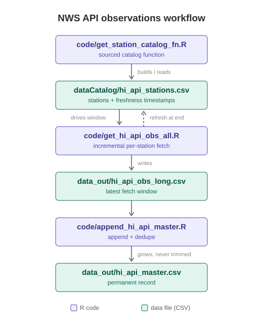

# NWS API observations workflow

Hourly, catalog-driven collection of surface observations for Hawaii
stations from the National Weather Service API (`api.weather.gov`), covering
six networks: airports (ASOS/AWOS), RAWS and Hawaiian Electric (MECO)
stations, RAWS fire-weather gauges, H1 hydro gauges, HADS coastal
stations, and buoys. Each run fetches only the data each station is
missing and folds it into a permanent, deduplicated master table.



## How it works

The pipeline is driven by a **station catalog** (`dataCatalog/hi_api_stations.csv`)
that records, for every station the API lists in Hawaii, its metadata plus two
freshness timestamps:

| Column | Meaning |
|---|---|
| `latest_obs_api` | newest observation available on the NWS API right now |
| `latest_obs_data` | newest observation already collected into our data |

Each run:

1. **Load the catalog** — `get_station_catalog()` (from
   `code/get_station_catalog_fn.R`, sourced) reads the cached catalog, or
   builds and writes it on the first run. If the cached copy is older than
   24 h it is rebuilt from the API first (see [Catalog
   staleness](#catalog-staleness)). The `dataCatalog/` folder is created at
   the project root automatically.
2. **Select live stations** — keep stations whose `latest_obs_api` falls
   within the last 7 days (the API's retention window). Dead catalog entries
   cost zero requests.
3. **Fetch incrementally** — each station is fetched from its own
   `latest_obs_data` to now, with a 12-hour minimum window and a 7-day cap.
   A station 3 days behind gets 3 days; one 4 hours behind gets 12 hours;
   a brand-new station gets the full 7 days. Fetches run in parallel.
4. **Write the snapshot** — `data_out/hi_api_obs_long.csv`, long format:
   `station_id | datetime | variable | value | unit | provider`
   (16 SI-unit variables requested, 14 of which have ever appeared;
   datetimes as `YYYY-MM-DD HH:MM:SS HST`).
5. **Refresh the catalog** — the run ends by rebuilding the catalog with
   updated timestamps, so the next run knows exactly what is missing.
6. **Append to the master** — `code/append_hi_api_master.R` folds the
   snapshot into `data_out/hi_api_master.csv`, deduplicating on
   `station_id + datetime + variable` (incoming rows win). The master is the
   permanent record and the only file that needs backing up.

Catch-up after downtime is automatic: fetch windows stretch to match
whatever gap the catalog reveals (up to the API's ~7-day retention — runs
must happen at least weekly to avoid gaps).

## Files

All R code lives in `code/`; data directories sit beside it at the project
root. Every path comes from the environment, so the scripts run correctly
from any working directory — and refuse to run at all without it.

```
$NWSAPI_PROJECT_ROOT/    <- REQUIRED; data_out/ and dataCatalog/ land here
|-- code/                <- all four .R files live here, together
`-- envs/nwsapi.env      <- the variables, ready to source
```

Nothing is inferred from a script's own location. `NWSAPI_PROJECT_ROOT` must
be exported before either script runs; an unset root, or one pointing at a
directory that does not exist, is a fatal error rather than a silent
fallback. See [Directory configuration](#directory-configuration).

| File | Role |
|---|---|
| `code/get_station_catalog_fn.R` | cache-aware catalog function (sourced; also runs standalone) |
| `code/get_hi_api_obs_all.R` | the fetcher — steps 1–5 above |
| `code/append_hi_api_master.R` | snapshot → master accumulator |
| `code/install_deps.R` | one-time CRAN dependency installer |
| `cron_api.txt` | ready-to-install hourly crontab entry |
| `envs/nwsapi.env` | the required directory variables, ready to `source` |
| `dataCatalog/hi_api_stations.csv` | station catalog with freshness timestamps |
| `data_out/hi_api_obs_long.csv` | latest fetch window (overwritten each run) |
| `data_out/hi_api_master.csv` | permanent deduplicated record |
| `runlogs/` | cron stdout/stderr logs (gitignored) |

### Directory configuration

All four paths come from the environment. Only the root is required; the
three directories default to the conventional subdirectories beneath it, so
a standard deployment needs just the one variable.

| Variable | Required | Default | Holds |
|---|---|---|---|
| `NWSAPI_PROJECT_ROOT` | **yes** | — | project root; everything below defaults relative to it |
| `NWSAPI_CODE_DIR` | no | `$NWSAPI_PROJECT_ROOT/code` | the `.R` files; must exist |
| `NWSAPI_DATA_OUT` | no | `$NWSAPI_PROJECT_ROOT/data_out` | snapshot + master; created on demand |
| `NWSAPI_DATA_CATALOG` | no | `$NWSAPI_PROJECT_ROOT/dataCatalog` | station catalog; created on demand |

`envs/nwsapi.env` holds these ready to source:

```bash
. /path/to/preliminary_nws_api_hourly/envs/nwsapi.env
```

**Why required rather than inferred.** The scripts used to derive the root
from their own location (`--file=` under `Rscript`, the sourced file's path
when sourced, the working directory otherwise). That last fallback was the
problem: sourced or launched in a way that lost the path, a run would
quietly build `data_out/` and `dataCatalog/` wherever it happened to be
standing and write a full fetch into the wrong tree. Requiring the variable
turns that silent mis-write into an immediate, readable abort:

```
Error: NWSAPI_PROJECT_ROOT is not set. This workflow requires its directories
to come from the environment -- export NWSAPI_PROJECT_ROOT (see
envs/nwsapi.env) before running.
```

The names are `NWSAPI_`-prefixed rather than a bare `PROJECT_ROOT`, so no two
of the hourly workflows can collide in a shell or crontab that has more than
one loaded.

## Usage

```bash
. envs/nwsapi.env                    # REQUIRED — sets NWSAPI_PROJECT_ROOT
Rscript code/get_hi_api_obs_all.R    # fetch (runs on 1 core)
Rscript code/append_hi_api_master.R  # fold into the master
```

Run both, in that order, on a schedule (hourly works well). The scripts take
every path from the environment, so they can be called from anywhere with no
`cd` — but the variables must be loaded first, in the same shell. Chain them
so a failed fetch does not re-fold a stale snapshot:

```bash
. /path/to/preliminary_nws_api_hourly/envs/nwsapi.env && \
  Rscript "$NWSAPI_PROJECT_ROOT/code/get_hi_api_obs_all.R" && \
  Rscript "$NWSAPI_PROJECT_ROOT/code/append_hi_api_master.R"
```

### Scheduling

`cron_api.txt` holds the ready-to-install crontab entry — copy its last
line into `crontab -e`:

```
7 * * * * /bin/sh -c '. <abs>/envs/nwsapi.env && C=${NWSAPI_CODE_DIR:-$NWSAPI_PROJECT_ROOT/code} \
            && /usr/bin/Rscript "$C/get_hi_api_obs_all.R" \
            && /usr/bin/Rscript "$C/append_hi_api_master.R"' \
            >> <abs>/runlogs/nwsapi_hrly.out 2>> <abs>/runlogs/nwsapi_hrly.err
```

**Sourcing the env file inside the cron command is mandatory.** Cron's
environment is minimal and inherits nothing from an interactive shell, so a
crontab line that just calls the scripts now aborts every run. The
`${NWSAPI_CODE_DIR:-...}` default keeps the line correct whether or not that
optional override is set in the env file.

**:07 past the hour.** Unlike the RR5 product there is no single issuance
to wait on — stations report on their own schedules, and the hourly cluster
runs :45 through :59: RAWS/MECO at :50 and :45 (201 stations), H1 gauges
sub-hourly at :00/:15/:30/:45 (142), ASOS airports last at :51–:59 (13).
Ingest lag is a few minutes. Starting at :07 means everything issued during
the previous clock hour has been both issued and ingested, so each run
collects a complete hour. Running at :55 would catch the RAWS block but cut
the airports off mid-report — no data lost, but airport observations would
always trail an hour.

:07 also staggers this workflow away from the RR5 job at :45. This one is
much heavier — ~380 station requests plus a full catalog rebuild (~580
listings and one observation request each), effectively serial since
`n_cores` is pinned to 1 — so a run takes about 5 minutes and finishes well
before :45.

The `/bin/sh -c '...'` wrapper is required, not cosmetic: written bare, the
redirects would attach only to the second command and the fetcher's output
would go to cron's mail instead of the log.

Output lands in `runlogs/` (gitignored, created on demand):

| File | Holds |
|---|---|
| `runlogs/nwsapi_hrly.out` | the full run transcript — every progress line |
| `runlogs/nwsapi_hrly.err` | **only** warnings and errors; empty after a clean run |

That split is why the scripts report progress with `say()` (a thin `cat()`
wrapper) rather than `message()`, and wrap `library()` in
`suppressPackageStartupMessages()` — both of those write to stderr in R,
which would otherwise fill `.err` with routine chatter on every run. A
station whose endpoint returns HTTP 500 shows up in `.err` as a one-line
warning while the run continues. Note the logs append, so they grow without
bound; rotate or truncate them if that matters.

### What a run needs locally

The fetcher needs exactly **one** other local file.

| Needed | Why |
|---|---|
| `NWSAPI_PROJECT_ROOT` exported | every path derives from it; unset is fatal at startup. See [Directory configuration](#directory-configuration). |
| `code/get_station_catalog_fn.R` | sourced by the fetcher; must sit in `$NWSAPI_CODE_DIR`. Missing it is fatal at startup. |
| R ≥ 4.1 plus `httr2`, `dplyr`, `purrr`, `tibble`, `readr` | `parallel` ships with R. Run `Rscript code/install_deps.R` once. |
| network access to `api.weather.gov` | no API key — the API only requires a `User-Agent` header, set in the scripts |

Everything else is optional, and is created or rebuilt automatically:

- `dataCatalog/hi_api_stations.csv` — built from the API if missing, and
  rebuilt if stale (see below). Having it just saves ~2 min on a run.
- `data_out/hi_api_obs_long.csv` — an output, not an input. It is read only
  at the end of a run, to derive `latest_obs_data`; if absent you get a
  warning and `NA` timestamps, nothing worse.
- `data_out/` and `dataCatalog/` — created on demand.

So a minimal deployment is **two `.R` files plus the packages**
(`get_hi_api_obs_all.R` and `get_station_catalog_fn.R`), or all four if you
also want the master accumulator and the dependency installer.

### Catalog staleness

The fetcher only pulls stations whose `latest_obs_api` is within
`alive_window` (7 days), so a catalog older than that matches no stations at
all — and the end-of-run refresh that would fix it is never reached, leaving
the pipeline permanently stuck. To prevent that, the catalog is age-checked
before use and rebuilt when older than `max_catalog_age` (24 h). Staleness is
measured two ways, and **either** one triggers a rebuild:

| Check | Catches |
|---|---|
| file mtime | nobody has run the pipeline lately |
| newest `latest_obs_api` in the file | the file was copied, restored, or touched, so its mtime lies |

A missing file, an absent `latest_obs_api` column, or an all-`NA` column (an
API outage during the last rebuild) all count as stale. As a backstop, if a
*cached* catalog yields zero live stations the fetcher forces one rebuild and
retries before giving up. In normal hourly operation none of this fires,
since every successful run refreshes the catalog at the end.

See the repository root `README.md` and `WORKFLOWS.md` for the companion
RR5 rainfall workflow (same design, driven by the hourly RR5HFO gauge
product) and the other tools in this toolkit.
