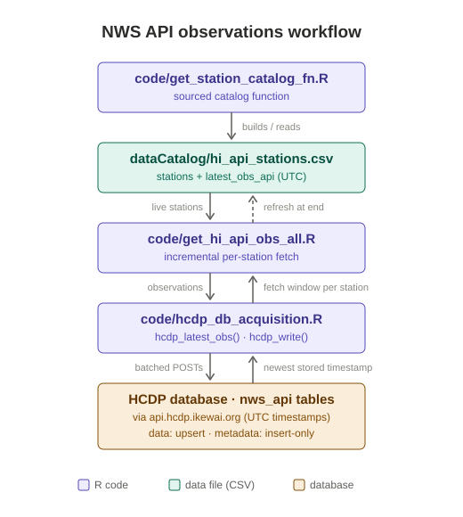

# NWS API observations workflow

Hourly, catalog-driven collection of surface observations for Hawaii
stations from the National Weather Service API (`api.weather.gov`), covering
six networks: airports (ASOS/AWOS), RAWS and Hawaiian Electric (MECO)
stations, RAWS fire-weather gauges, H1 hydro gauges, HADS coastal
stations, and buoys. Each run asks the HCDP database what it already holds,
fetches only the data each station is missing, and writes it to the
database's `nws_api` tables through the HCDP acquisition API. Nothing but the
station catalog is written locally.

> **Status 2026-10-30: writing to the live database.** The first successful
> run (12:03–12:22 HST) wrote 789,213 observation rows — the NWS API's full
> 7-day window, `2026-10-23T22:06Z` onward — plus 303 stations and 14
> variables. Hourly runs continue incrementally from the database's newest
> timestamps. `2026-10-22T01:09Z` → `2026-10-23T22:06Z` aged out of the NWS
> API before writes worked and is lost. See [Known issues](#known-issues).



## How it works

The pipeline is driven by two sources of truth:

| Source | Answers |
|---|---|
| **station catalog** (`dataCatalog/hi_api_stations.csv`) | which stations exist, their metadata, and `latest_obs_api` — the newest observation on the NWS API right now |
| **HCDP database** (`nws_api` tables) | the newest observation already collected for each station |

Each run:

1. **Load the catalog** — `get_station_catalog()` (from
   `code/get_station_catalog_fn.R`, sourced) reads the cached catalog, or
   builds and writes it on the first run. If the cached copy is older than
   24 h it is rebuilt from the API first (see [Catalog
   staleness](#catalog-staleness)). The `dataCatalog/` folder is created at
   the project root automatically.
2. **Select live stations** — keep stations whose `latest_obs_api` falls
   within the last 7 days (the API's retention window). Dead catalog entries
   cost zero requests.
3. **Ask the database** — `hcdp_latest_obs()` looks up each live station's
   newest stored timestamp (one `GET .../nws_api/data?station_ids=X&limit=1`
   per station: the API applies `limit` to the whole result, not per
   station).
4. **Fetch incrementally** — each station is fetched from that timestamp to
   now, with a 12-hour minimum window and a 7-day cap. A station 3 days
   behind gets 3 days; one 4 hours behind gets 12 hours; a station not yet
   in the database gets the full 7 days.
5. **Write to the database** — `hcdp_write()` posts to the three `nws_api`
   tables in batches under the API's 100 KB request limit:

   | Table | Rows | On an existing key |
   |---|---|---|
   | `stationMetadata` | `station_id, station_name, data_provider, skn, lat, lng` | replaced (upsert) |
   | `variableMetadata` | `variable, unit` | left as is (insert-only) |
   | `data` | `station_id, timestamp, variable, value` | replaced (upsert) |

   Metadata goes first. Station metadata is upserted every run, as in the
   MADIS workflow, so name, provider, location and `skn` track their sources
   (see [SKN](#skn)); `data_provider` is NOT NULL, so stations the NWS API
   lists without a provider are sent as `"unknown"`. Observations upsert on
   `station_id + timestamp + variable`, so a re-fetched value replaces the
   stored one (16 SI-unit variables requested, 14 of which have ever
   appeared). Timestamps are UTC, ISO 8601 `YYYY-MM-DDTHH:MM:SSZ`; nothing is
   converted to Hawaii local time.
6. **Optionally refresh the catalog** — off by default
   (`NWSAPI_CATALOG_REFRESH_AT_END`). The workflow runs in a fresh container
   each time, so a catalog rebuilt at the end would be thrown away; each run
   builds or age-checks its own at step 1 instead. See [Catalog
   staleness](#catalog-staleness).

Catch-up after downtime is automatic: fetch windows stretch to match
whatever gap the database reveals (up to the API's ~7-day retention — runs
must happen at least weekly to avoid gaps). A run that dies while writing
leaves each station's newest stored timestamp where it stopped, so the next
run picks up from there.

## SKN

Each station's `skn` comes from the HCDP master station list,
[`Hawaii_Master_Station_Meta.csv`](https://raw.githubusercontent.com/ikewai/hawaii_wx_station_mgmt_container/main/Hawaii_Master_Station_Meta.csv),
matched exactly as the MADIS workflow (`madis_hourly_aqs.py`) does:

- a station's `station_id` is looked up in the list's `NWS.id` column, and
  the matching row's `SKN` is sent (as a number);
- an `NWS.id` listed more than once is ambiguous and treated as unmatched,
  and logged each run (currently `080HI` and `WUHH1`);
- unmatched stations get a null `skn`.

The list is downloaded once per run, **before** anything is fetched. Because
station metadata is upserted, a run that cannot load it stops with an error
rather than sending null `skn`s that would wipe the stored ones. As of
2026-11-06, 140 of the 305 stations have an `skn`; most unmatched stations
are the HECO `NNNHE` sites, which the master list does not carry under their
NWS IDs. `HCDP_MASTER_META_URL` overrides the list's URL.

## Timestamps are UTC

Every timestamp the workflow writes — observation `timestamp`s sent to the
database and `latest_obs_api` in the catalog — is UTC in ISO 8601 form,
`YYYY-MM-DDTHH:MM:SSZ` (e.g. `2026-08-19T21:50:00Z`). Nothing is converted to
Hawaii local time, and the container runs with `TZ=UTC`. The database
returns UTC as well unless a reader passes `local_tz=true`.

Reading is deliberately lenient: `parse_utc()` (in
`code/get_station_catalog_fn.R`) accepts the `Z` form, the NWS API's
`+00:00` offsets, the HCDP API's fractional seconds (`...00.000Z`), and the
legacy `YYYY-MM-DD HH:MM:SS HST` text earlier versions wrote — so an old
catalog left on disk still drives a correct run.

## Legacy local data

Until 2026-10-21 the workflow kept its record locally, written in
Hawaii-local `... HST` text. Those files are no longer written; they were
converted to UTC in place on 2026-10-21 (only the timestamp text changed,
verified byte for byte; Hawaii has no DST, so every value maps to exactly
one UTC instant):

| File | Contents |
|---|---|
| `data_out/hi_api_master.csv` | 14,691,546 rows, `2026-08-19T21:44:00Z` to `2026-10-16T02:41:00Z` — the full pre-database record, **not** in the database unless backfilled |
| `data_out/hi_api_obs_long.csv` | the last local snapshot (2026-10-15) |
| `backup_hst_20261021/` | the original HST files, untouched (gitignored); delete once no longer needed |

`code/append_hi_api_master.R` is kept but no longer run; it still rewrites
any legacy HST rows to UTC if pointed at an old file.

## Files

All R code lives in `code/`; data directories sit beside it at the project
root. Every path comes from the environment, so the scripts run correctly
from any working directory — and refuse to run at all without it.

```
$NWSAPI_PROJECT_ROOT/    <- REQUIRED; dataCatalog/ lands here
|-- code/                <- the .R files live here, together
|-- envs/nwsapi.env      <- the variables, ready to source
`-- token.env            <- HCDP API token (gitignored; never committed)
```

Nothing is inferred from a script's own location. `NWSAPI_PROJECT_ROOT` must
be exported before either script runs; an unset root, or one pointing at a
directory that does not exist, is a fatal error rather than a silent
fallback. See [Directory configuration](#directory-configuration).

| File | Role |
|---|---|
| `code/get_station_catalog_fn.R` | cache-aware catalog function (sourced; also runs standalone) |
| `code/get_hi_api_obs_all.R` | the fetcher — steps 1–6 above |
| `code/hcdp_db_acquisition.R` | HCDP acquisition API client: `hcdp_latest_obs()`, `hcdp_write()`. Sourcing it sends no requests; *running* it executes its examples, which include POSTs of empty data to all four sources' tables |
| `code/append_hi_api_master.R` | legacy local master accumulator — no longer run |
| `code/install_deps.R` | one-time CRAN dependency installer |
| `cron_api.txt` | ready-to-install hourly crontab entry |
| `envs/nwsapi.env` | the required directory variables, ready to `source` |
| `containers/Dockerfile`, `containers/task.sh`, `envs/prod.env` | container image and entrypoint — see [Container](#container) |
| `token.env` | HCDP API token, read at run time (gitignored) |
| `dataCatalog/hi_api_stations.csv` | station catalog with `latest_obs_api` |
| `data_out/hi_api_master.csv` | legacy local record (Aug 19 – Oct 15 2026, UTC); no longer written — see [Legacy local data](#legacy-local-data) |
| `runlogs/` | cron stdout/stderr logs (gitignored) |

### Directory configuration

All four paths come from the environment. Only the root is required; the
three directories default to the conventional subdirectories beneath it, so
a standard deployment needs just the one variable.

| Variable | Required | Default | Holds |
|---|---|---|---|
| `NWSAPI_PROJECT_ROOT` | **yes** | — | project root; everything below defaults relative to it |
| `NWSAPI_CODE_DIR` | no | `$NWSAPI_PROJECT_ROOT/code` | the `.R` files; must exist |
| `NWSAPI_DATA_OUT` | no | `$NWSAPI_PROJECT_ROOT/data_out` | legacy local master; read only by `append_hi_api_master.R` |
| `NWSAPI_DATA_CATALOG` | no | `$NWSAPI_PROJECT_ROOT/dataCatalog` | station catalog; created on demand |

`envs/nwsapi.env` holds these ready to source:

```bash
. /path/to/preliminary_nws_api_hourly/envs/nwsapi.env
```

**Why required rather than inferred.** The scripts used to derive the root
from their own location (`--file=` under `Rscript`, the sourced file's path
when sourced, the working directory otherwise). That last fallback was the
problem: sourced or launched in a way that lost the path, a run would
quietly build `data_out/` and `dataCatalog/` wherever it happened to be
standing and write a full fetch into the wrong tree. Requiring the variable
turns that silent mis-write into an immediate, readable abort:

```
Error: NWSAPI_PROJECT_ROOT is not set. This workflow requires its directories
to come from the environment -- export NWSAPI_PROJECT_ROOT (see
envs/nwsapi.env) before running.
```

The names are `NWSAPI_`-prefixed rather than a bare `PROJECT_ROOT`, so no two
of the hourly workflows can collide in a shell or crontab that has more than
one loaded.

## Usage

```bash
. envs/nwsapi.env                    # REQUIRED — sets NWSAPI_PROJECT_ROOT
Rscript code/get_hi_api_obs_all.R    # fetch and write to the database (1 core)
```

**Run it once an hour, at :07 past the hour** (cron `7 * * * *`) — see
[Scheduling](#scheduling) for why :07. The script takes every path from
the environment, so it can be called from anywhere with no `cd` — but the
variables must be loaded first, in the same shell:

```bash
. /path/to/preliminary_nws_api_hourly/envs/nwsapi.env && \
  Rscript "$NWSAPI_PROJECT_ROOT/code/get_hi_api_obs_all.R"
```

The database client reads two more variables, both optional:

| Variable | Default | Purpose |
|---|---|---|
| `HCDP_TOKEN_FILE` | `$NWSAPI_PROJECT_ROOT/token.env` | file holding the API token — the bare token, or a `NAME=value` line |
| `HCDP_API_URL` | `https://api.hcdp.ikewai.org` | API base URL (point it at a test server) |
| `HCDP_MASTER_META_URL` | the `Hawaii_Master_Station_Meta.csv` URL above | master station list used for `skn` (see [SKN](#skn)) |
| `NWSAPI_CATALOG_REFRESH_AT_END` | `false` | `true` (or `1` / `yes`) also rebuilds the catalog at the end of each run — only useful where `dataCatalog/` persists between runs |

The token needs `meso_admin` permission, which the API requires for writes.
A missing or empty token file stops the run at startup, before any fetching.

### Scheduling

`cron_api.txt` holds the ready-to-install crontab entry — copy its last
line into `crontab -e`:

```
7 * * * * /bin/sh -c '. <abs>/envs/nwsapi.env && C=${NWSAPI_CODE_DIR:-$NWSAPI_PROJECT_ROOT/code} \
            && /usr/bin/Rscript "$C/get_hi_api_obs_all.R"' \
            >> <abs>/runlogs/nwsapi_hrly.out 2>> <abs>/runlogs/nwsapi_hrly.err
```

**Sourcing the env file inside the cron command is mandatory.** Cron's
environment is minimal and inherits nothing from an interactive shell, so a
crontab line that just calls the scripts now aborts every run. The
`${NWSAPI_CODE_DIR:-...}` default keeps the line correct whether or not that
optional override is set in the env file.

**When: :07 past every hour.** This applies however the job is launched —
cron here, or the HCDP task runner for the container. Hawaii's offset from
UTC is a whole number of hours, so :07 is the same minute in HST and UTC,
and `7 * * * *` is correct whichever timezone the scheduler uses.

**Why :07.** Unlike the RR5 product there is no single issuance
to wait on — stations report on their own schedules, and the hourly cluster
runs :45 through :59: RAWS/MECO at :50 and :45 (201 stations), H1 gauges
sub-hourly at :00/:15/:30/:45 (142), ASOS airports last at :51–:59 (13).
Ingest lag is a few minutes. Starting at :07 means everything issued during
the previous clock hour has been both issued and ingested, so each run
collects a complete hour. Running at :55 would catch the RAWS block but cut
the airports off mid-report — no data lost, but airport observations would
always trail an hour.

:07 also staggers this workflow away from HADS at :20 and RR5 at :45. This
one is much heavier — ~380 database lookups, ~380 station requests, a few
hundred batched POSTs (about 200 for a typical hourly run of ~90–110k
rows), and — in a fresh container, or when the cached catalog is over 24 h
old — a catalog build (~580 listings and one observation request each), all
effectively serial since `n_cores` is pinned to 1. Measured against the live
database, an hourly run takes **about 5 minutes** (a fresh-container run on
2026-11-09, catalog build included: 312 s), so it finishes long before :20;
a full 7-day catch-up (empty database, ~790k rows, ~1,600 POSTs) took about
20 minutes.

**Once an hour, no more often.** Every run already re-fetches at least the
last 12 hours, so extra runs add load without adding data. Two runs that
overlap are harmless — writes are keyed upserts, so the database still ends
up with one row per observation — but they double the requests to both
APIs. After downtime, just let the next :07 run catch up (up to 7 days).

The `/bin/sh -c '...'` wrapper keeps the redirects applied to the whole
chain, so anything the env file or the fetcher prints lands in the log
rather than in cron's mail.

Output lands in `runlogs/` (gitignored, created on demand):

| File | Holds |
|---|---|
| `runlogs/nwsapi_hrly.out` | the full run transcript — every progress line |
| `runlogs/nwsapi_hrly.err` | **only** warnings and errors; empty after a clean run |

That split is why the scripts report progress with `say()` (a thin `cat()`
wrapper) rather than `message()`, and wrap `library()` in
`suppressPackageStartupMessages()` — both of those write to stderr in R,
which would otherwise fill `.err` with routine chatter on every run. A
station whose endpoint returns HTTP 500 shows up in `.err` as a one-line
warning while the run continues. Note the logs append, so they grow without
bound; rotate or truncate them if that matters.

### What a run needs locally

The fetcher needs exactly **three** other local files.

| Needed | Why |
|---|---|
| `NWSAPI_PROJECT_ROOT` exported | every path derives from it; unset is fatal at startup. See [Directory configuration](#directory-configuration). |
| `code/get_station_catalog_fn.R` | sourced by the fetcher; must sit in `$NWSAPI_CODE_DIR`. Missing it is fatal at startup. |
| `code/hcdp_db_acquisition.R` | the database client, sourced likewise. |
| `token.env` | the HCDP API token (or the file `$HCDP_TOKEN_FILE` names). Missing it is fatal at startup. |
| R ≥ 4.1 plus `httr2`, `jsonlite`, `dplyr`, `purrr`, `tibble`, `readr` | `parallel` ships with R. `jsonlite` is only *suggested* by `httr2`, so it must be listed explicitly. Run `Rscript code/install_deps.R` once. |
| network access to `api.weather.gov` | no API key — the API only requires a `User-Agent` header, set in the scripts |
| network access to `api.hcdp.ikewai.org` | the database lookups and writes; an unreachable API fails the run before it fetches |
| network access to `raw.githubusercontent.com` | the master station list for `skn`; unreachable fails the run before it fetches |

Everything else is optional, and is created or rebuilt automatically:

- `dataCatalog/hi_api_stations.csv` — a cache, **not** state: built from the
  API if missing, and rebuilt if stale (see below). What has been collected
  lives in the database, so a run that starts without it — every run in a
  fresh container — loses nothing; keeping it just saves ~2 min on a run.
- `dataCatalog/` — created on demand. It must be writable, because each run
  that builds the catalog writes it there, even in a container where the
  file is discarded afterwards.

### Container

Pushes to `main` that touch `code/`, `containers/` or `envs/prod.env` build
and push `ghcr.io/hcdp/task-preliminary-nws-api-hourly` via
`.github/workflows/build-and-push.yml`. The image (on
`ghcr.io/hcdp/task-base`) installs `httr2`, `jsonlite`, `dplyr`, `tibble`
and `readr`, and copies `code/`, `envs/prod.env` and `containers/task.sh`.
`task.sh` sets `TZ=UTC`, sources `envs/prod.env` (which sets
`NWSAPI_PROJECT_ROOT=/workspace/`), and runs the fetcher — there is no
append step any more. The image's `CMD` runs `task.sh`. Schedule the
container **at :07 past every hour**, like the cron job — see
[Scheduling](#scheduling). Nothing needs to persist between container runs:
each run builds its station catalog at the start and, with
`NWSAPI_CATALOG_REFRESH_AT_END` at its default `false`, does not rebuild it
at the end.

The token is **not** in the image and is provisioned manually: place it at
`/workspace/token.env`, or anywhere with `HCDP_TOKEN_FILE` pointing at it.
Without one the container stops at startup with `token file not found`,
before fetching anything.

### Catalog staleness

The fetcher only pulls stations whose `latest_obs_api` is within
`alive_window` (7 days), so a catalog older than that matches no stations at
all — and a run that targets no stations never reaches the point where it
could refresh the catalog, leaving the pipeline permanently stuck. To prevent
that, the catalog is age-checked before use and rebuilt when older than
`max_catalog_age` (24 h). Staleness is measured two ways, and **either** one
triggers a rebuild:

| Check | Catches |
|---|---|
| file mtime | nobody has run the pipeline lately |
| newest `latest_obs_api` in the file | the file was copied, restored, or touched, so its mtime lies |

A missing file, an absent `latest_obs_api` column, or an all-`NA` column (an
API outage during the last rebuild) all count as stale. As a backstop, if a
*cached* catalog yields zero live stations the fetcher forces one rebuild and
retries before giving up.

This check is also what keeps a *persisted* catalog current now that the
end-of-run rebuild is off by default: where `dataCatalog/` survives between
runs (the cron job on this host), the first run after the file turns 24 h
old rebuilds it, so `latest_obs_api` is at most a day old. That only decides
which stations count as alive; a station that comes back online is picked
up at the next rebuild with its full backlog, since the NWS API keeps 7
days. In a fresh container the file is always missing, so every run builds
it. Set `NWSAPI_CATALOG_REFRESH_AT_END=true` to rebuild after every run
instead.

## Known issues

| Issue | Effect | Fix |
|---|---|---|
| ~~Token could not write~~ (HTTP 403 "User does not have permission to perform this action.") | 189 runs refused, 2026-10-21 18:07 → 2026-10-29. The API checks `'meso_admin' = ANY(permissions)` for the token's row in its `auth_token_store` table | resolved by 2026-10-29 ~14:00 — `meso_admin` granted. Probe permission safely with an empty POST (`{"data": []}`): permission-checked, writes nothing |
| ~~`data_provider` is NOT NULL~~ in `station_metadata_nws_api`; a few stations (5 reporting, including 4 buoys) list no provider, and one null rejected the whole batch (HTTP 400) and stopped the run | 21 runs failed this way after the permission fix | fixed 2026-10-30: sent as `"unknown"`. `skn` is nullable |
| ~~Host cannot reach `api.hcdp.ikewai.org`~~ | resolved by 2026-10-29: connections succeed (connect ~0.14 s) | — |
| Table renamed upstream: the API's variable-metadata write route is `variableMetadata` since `hcdp_api` commit `089bd97` (2026-10-26); `varMetadata` returns 404 | fixed in this workflow on 2026-10-29 | — |
| **Gaps in the record** | the stale crontab, the unreachable API, the 403 and the null `data_provider` kept anything from being stored between 2026-10-16T02:41Z and the first successful write. The database starts at `2026-10-23T22:06Z`; `2026-10-16T02:42Z` → `2026-10-22T01:09Z` survives only in a one-off test fetch outside the repo, and `2026-10-22T01:09Z` → `2026-10-23T22:06Z` is lost. The legacy master (Aug 19 – Oct 16) is not in the database | backfill the legacy master and the test-fetch backlog; consider a local spill file when a write fails, since a failed run discards its fetch |
| ~~`envs/prod.env` exported `PROJECT_ROOT`, not `NWSAPI_PROJECT_ROOT`~~ | the container aborted at startup | fixed 2026-11-09 in `prod.env` and `dev.env`; the container now needs only its token (provisioned manually) |
| Not every station has an `skn` | 165 of 305 stations have no unambiguous `NWS.id` match in the master station list (most are HECO `NNNHE` sites; `080HI` and `WUHH1` are listed twice). The `skn` column is nullable, so this is not an error | add the stations, or fix the duplicate `NWS.id`s, in the master station list; the next run picks them up |
| Live database untested | everything was verified against a local mock built from the API's source (`HCDP/hcdp_api`, `src/app/endpoints/hcdp/acquisition/acquisition.ts`, commit `7bbc552`): ordering and `limit`, upsert vs. insert-only, payload validation, the 100 KB body limit | once the host can connect, make one read-only request to confirm the token, then a real run |

`HCDP_API_URL` points the client at any server speaking the same API, which
is how the mock was used.

See `../WORKFLOWS.md` for the index of the four hourly workflows. Note that
this workflow now writes to the HCDP database, while the companion RR5 and
HADS workflows still keep local master CSVs.
